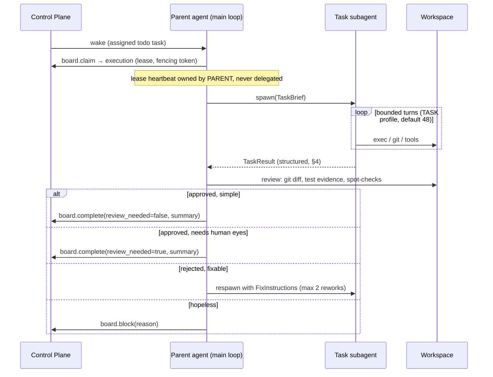

# Subagent Task Execution — Design Spec

> **Status:** Draft v1 (for Ross's review)
> Companion to [ADR-0016](adr/0016-agent-driven-board-transitions.md).
> Builds on the existing `spawn_subagent` machinery (S-160/S-163,
> `agent-runtime/skquad_runtime/subagents.py`).

## 1. Goal

Move the *execution* of a task out of the agent's main chat loop into a
subagent spawned by the assignee agent, so that:

1. **Main-chat context stays thin.** A series of N tasks costs the chat
   ~N result summaries, not N full work transcripts (tool outputs,
   retries, file dumps).
2. **The parent reviews the work.** The assignee agent inspects the
   subagent's actual output (diff, tests) before choosing the terminal
   board transition (`done` self-approved vs `in-review` vs re-work).
3. **Failures are contained.** A subagent that burns its turn budget or
   produces garbage returns a structured failure; the parent's chat
   context is unharmed.

## 2. Non-goals

- Separate pods/jobs for subagents. The subagent remains an **in-process
  nested LLM loop** (S-160 model). No new scheduling surface.
- Subagent board access. The subagent **never** calls `board.*` verbs.
  All board transitions belong to the parent (see §5 lease rule).
- Replacing ad-hoc `spawn_subagent` (digging/lookup). Task execution
  uses the same machinery with a different profile.

## 3. Execution model



### Invariants

- **I1 — Parent holds the lease.** The `task_execution` (worker ID,
  lease, fencing token) is created by the parent's `board.claim` and is
  never passed to the subagent. The parent's heartbeat thread renews as
  usual. Subagent work happens *under* the parent's execution. Crash of
  the pod kills both; the reaper re-queues per the existing model
  (kanban-task-lifecycle §8–9). No new failure domain.
- **I2 — Subagent starts from empty context.** Same as S-160: only the
  TaskBrief is in context. The composed system prompt is inherited
  byte-identical; `board.*` and `spawn_subagent` are stripped from the
  subagent tool list (no recursion, no board writes).
- **I3 — Only the TaskResult crosses back.** Intermediate tool outputs
  stay in the subagent. The S-163 transparency caps still apply for the
  chat-visible progress thread.
- **I4 — Parent review is against artifacts, not prose.** The parent
  verifies `changed_files`/`commit_sha`/`tests_run` against the actual
  workspace before completing the task. A TaskResult whose claimed SHA
  doesn't match the workspace is a forced `review_needed=true`.

### Visibility (S-301)

Nested-run transparency is a **replaceable snapshot**, not a message
stream. After each completed turn the runner publishes
`{"thread": [...], "turns": N, "steps": [...]}` (the S-163-captured
thread, caps included) to `POST /agents/me/tasks/{id}/subagent-thread`,
which overwrites the view on the active `task_execution` row. The chat
task card's **Details** button opens the same right-hand
`SubagentThreadPanel` used by the regular `spawn_subagent` chip, polling
`GET /tasks/{id}/subagent-thread`.

The S-299 design (one `[subagent] turn N` message row per nested turn,
inline in the chat and the task card) was retired: those rows surfaced
in the main chat feed — which lists every message addressed to the
agent — and buried useful lifecycle events under up to 80 noise lines
per run. Migration 0067 purges the historical rows.

## 4. TaskResult contract (v1)

Returned by the subagent as its final structured message; validated
client-side (runtime) before the parent sees it. Invalid shape →
treated as `succeeded: false, failure_class: "contract_violation"`.

```json
{
  "schema": "skquad.task_result.v1",
  "succeeded": true,
  "summary": "Added rate-limit header middleware; 14 tests pass.",
  "changed_files": ["server/middleware/ratelimit.go", "server/middleware/ratelimit_test.go"],
  "commit_sha": "abc1234",
  "branch": "feat/s300-ratelimit",
  "tests": {
    "run": true,
    "command": "go test ./server/middleware/...",
    "passed": 14, "failed": 0, "skipped": 0
  },
  "proposed_status": "done",
  "review_recommended": false,
  "review_notes": "Mechanical change, fully covered by tests.",
  "concerns": [],
  "turns_used": 11,
  "artifacts": [
    {"kind": "log", "name": "test-output", "truncated": true}
  ]
}
```

Field rules:

| Field | Rule |
|---|---|
| `succeeded` | `false` ⇒ `failure_class` + `summary` required. Board never moves toward done on `succeeded: false`. |
| `failure_class` | One of: `contract_violation`, `turn_budget`, `tool_error`, `dependency_missing`, `access_denied`, `aborted`, `other`. Drives parent rework policy and metrics. |
| `proposed_status` | `"done"` \| `"in-review"` \| `"blocked"` — a *proposal only*; the parent decides (D2 of ADR-0016 governs the final call). |
| `review_recommended` | Subagent's honest confidence signal. Parent prompt: never downgrade a `true` to self-approve without an artifact-backed reason. |
| `commit_sha` / `branch` | Required when the task ran against a git workspace; parent cross-checks (I4). |
| `tests` | Required unless the task brief declared `tests: n/a`. |
| `concerns` | Free-text list surfaced verbatim into the parent's review context and into the completion summary if `in-review`. |

Failure example:

```json
{
  "schema": "skquad.task_result.v1",
  "succeeded": false,
  "failure_class": "turn_budget",
  "summary": "Exhausted 48 turns mid-refactor; branch has 3 uncommitted files.",
  "changed_files": ["..."], "commit_sha": "",
  "branch": "feat/s301-x",
  "tests": {"run": false},
  "proposed_status": "blocked",
  "review_recommended": true,
  "review_notes": "Needs decision: split task or raise budget.",
  "concerns": ["uncommitted work on branch"],
  "turns_used": 48, "artifacts": []
}
```

## 5. TaskBrief (parent → subagent input)

```json
{
  "schema": "skquad.task_brief.v1",
  "task_id": "...", "task_number": 301,
  "title": "...", "description": "...",
  "acceptance_criteria": ["..."],
  "workspace": {"resource_id": "...", "branch_hint": "feat/s301-x"},
  "reviewer_feedback": "Ross: rate limit must be per-IP, not global.",
  "attempt": 2,
  "prior_result": { "...": "TaskResult of attempt 1, when rework" }
}
```

`reviewer_feedback` is the ADR-0016 D3 hook: chat-originated feedback is
carried **verbatim** into the brief so nothing is lost in paraphrase.

## 6. Rework policy

- Parent may respawn with `FixInstructions` (embedded as
  `prior_result` + explicit fix list): **max 2 reworks** per task
  attempt cycle (configurable `SKQUAD_TASK_REWORK_MAX=2`).
- Rework respawn inherits the workspace branch — the second subagent
  continues, not restarts.
- Rework exhaustion ⇒ parent must `board.block` with a summary of the
  cycle. No third spawn.

## 7. Configuration

| Env / setting | Default | Purpose |
|---|---|---|
| `SKQUAD_TASK_SUBAGENT_ENABLED` | `true` | Master switch; `false` = legacy in-loop execution (fallback path preserved). |
| `SKQUAD_TASK_SUBAGENT_MAX_TURNS` | `128` (S-298) | Task profile (distinct from ad-hoc 12). Injected by the operator: per-agent `spec.taskSubagentMaxTurns` wins; else the operator's `SKQUAD_AGENT_TASK_SUBAGENT_MAX_TURNS` (platform default 128). |
| `SKQUAD_TASK_REWORK_MAX` | `2` | Rework spawns per cycle. |
| `SKQUAD_SUBAGENT_*` (existing) | unchanged | Ad-hoc digging profile. |

S-298: the turn budget is user-configurable per agent from the agent
Configuration tab ("Task turn budget", 1–512; empty = inherit the
platform default). Chain: UI → `PATCH /agents/{id}` →
`agents.task_subagent_max_turns` (nullable) → Agent CR
`spec.taskSubagentMaxTurns` → operator → pod env.

Kill-switch behaviour: with the feature disabled, the runtime falls back
to today's direct task loop — this spec must not remove that path until
the new one has survived one full release cycle.

## 8. Metering & observability

- All subagent LLM calls carry `skquad_subagent: true` **and**
  `skquad_task_id` in gateway metadata (extends S-160 marker) →
  per-task cost rollups and the S-269 resource-metering dim line up.
- New metrics: `skquad_task_subagent_runs_total{outcome,failure_class}`,
  `skquad_task_subagent_turns_used` (histogram),
  `skquad_task_rework_total`.
- Budget enforcement is unaffected: enforcement remains
  stop-at-end-of-turn at the parent (ADR-0016/lifecycle §10). A
  budget-block mid-subagent-run completes the current *tool step*,
  returns the partial TaskResult, and the parent ends the turn.

## 9. Failure modes

| Failure | Handling |
|---|---|
| Subagent dies/raises | Parent catches, gets synthetic `failure_class: "other"` result; may rework once or block. |
| Contract violation | Synthetic failed TaskResult; counts against rework budget; prompt fix if frequent. |
| Pod killed mid-subagent | I1: parent's lease lapses → reaper re-queues (~4 min) → fresh pod, fresh claim. Existing path, no special case. |
| Parent reviews and disagrees with `proposed_status` | Parent overrides — proposal is advisory. Override reason goes in completion summary. |
| Subagent claims SHA not in workspace | Forced `review_needed=true` + concern recorded (I4). |
| Turn budget hit with uncommitted work | `failure_class: turn_budget` + branch/`changed_files` still reported so nothing is lost; parent decides commit-or-block. |

## 10. Migration & rollout

1. Land behind `SKQUAD_TASK_SUBAGENT_ENABLED=false` initially; legacy
   loop untouched.
2. Shadow-test on one pilot squad; compare context-window curves and
   completion quality vs legacy.
3. Flip default on after one clean release cycle; keep the legacy flag
   for one further cycle, then remove (separate cleanup ticket).

## 11. Open questions

1. Should the parent review be *hard-required* before `review_needed=false`
   (i.e., parent must run at least one verification tool call), or is
   trusting the artifact cross-check enough?
2. Do subagents get the workspace `exec` tool with the same timeout as
   the parent, or a tighter one?
3. Should TaskResults be persisted on the `task_execution` row (audit)
   or live only in chat/audit-log? Proposed: persist on the execution row
   (`result_detail` JSON) — cheap and makes the review trail queryable.
